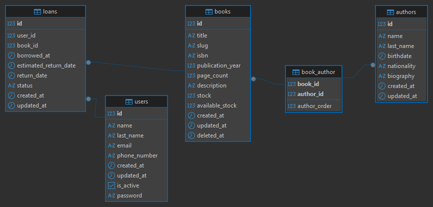

# Med Library — Sistema de Gestión de Biblioteca

Aplicación web y API REST desarrollada en **Laravel 11** con **PostgreSQL**, autenticación mediante **Laravel Sanctum** y una interfaz reactiva construida con **Blade**, **Alpine.js** y **Tailwind CSS**.

## Requisitos Previos

* **PHP** >= 8.2 (con extensiones `pdo_pgsql`, `pgsql`, `mbstring`, `openssl`, `tokenizer`, `xml`, `ctype`, `json`)
* **Composer** >= 2.6
* **PostgreSQL** >= 14 (con soporte para la extensión `pg_trgm` si utilizas búsqueda por similitud/trigramas)
* **Node.js** >= 18 y **NPM** (opcional si deseas compilar assets localmente con Vite en lugar de usar CDN)
* Entorno local como **Laravel Herd**, Laragon o Docker

---

## Esquema de Base de Datos

El modelo relacional en PostgreSQL gestiona los usuarios, libros, autores (con relación muchos a muchos ordenable) y el historial de préstamos con restricciones de integridad referencial y de stock:



---

## Instalación y Configuración Paso a Paso

### 1. Clonar el repositorio e instalar dependencias

```bash
git clone https://github.com/alexisarango2144/med_library med_library
cd med_library
composer install
```

*(Opcional) Si deseas compilar Tailwind CSS y Alpine.js de forma local con Vite:*

```bash
npm install
```

### 2. Configurar variables de entorno

Copia el archivo de ejemplo y genera la clave de aplicación de Laravel:

```bash
cp .env.example .env
php artisan key:generate
```

Edita el archivo `.env` con los datos de conexión a tu base de datos **PostgreSQL** y la URL local del proyecto:

```env
APP_NAME="Med Library"
APP_ENV=local
APP_DEBUG=true
APP_URL=https://med-library.test

DB_CONNECTION=pgsql
DB_HOST=127.0.0.1
DB_PORT=5432
DB_DATABASE=med_library
DB_USERNAME=postgres
DB_PASSWORD=tu_contraseña
```

### 3. Crear la base de datos en PostgreSQL

Si aún no has creado la base de datos `med_library`, créala desde la terminal usando `psql` o `createdb` (también puedes hacerlo desde pgAdmin, DBeaver o TablePlus):

* **Con `psql`:**
  ```bash
  psql -U postgres -c "CREATE DATABASE med_library;"
  ```

* **Con el comando `createdb`:**
  ```bash
  createdb -U postgres med_library
  ```

*(Nota: Si en tu entorno PostgreSQL corre en un puerto distinto al `5432`, por ejemplo `5433`, añade `-p 5433` al comando).*

### 4. Ejecutar migraciones y seeders

Crea las tablas en PostgreSQL y carga los datos iniciales de prueba (usuarios, autores y libros):

```bash
php artisan migrate --seed
```

> **Nota:** Si necesitas reiniciar la base de datos desde cero durante desarrollo:
>
> ```bash
> php artisan migrate:fresh --seed
> ```

### 5. Configurar tareas programadas (Préstamos Vencidos)

El sistema incluye un comando Artisan (`loans:mark-overdue`) para marcar automáticamente como `overdue` los préstamos activos con más de **15 días**.

* **Para probarlo manualmente en desarrollo:**
  ```bash
  php artisan loans:mark-overdue
  ```

* **Para ejecutarlo automáticamente en local:**
  ```bash
  php artisan schedule:work
  ```

* **En producción (Cron del servidor):**
  ```cron
  * * * * * cd /ruta/a/med_library && php artisan schedule:run >> /dev/null 2>&1
  ```

### 6. Levantar el servidor de desarrollo

Si utilizas **Laravel Herd**, el sitio estará disponible automáticamente en `https://med-library.test`.

De lo contrario, inicia el servidor integrado de Artisan:

```bash
php artisan serve
```

*(Si optaste por compilar assets localmente con Vite, ejecuta en una segunda terminal `npm run dev`).*

## Credenciales de Prueba por Defecto

Si ejecutaste los seeders configurados, puedes iniciar sesión en `/login` o mediante `POST /api/login` con:

* **Correo electrónico:** `admin@medlibrary.test`
* **Contraseña:** `password123`

## Colección de Pruebas en Postman

El repositorio incluye una colección lista para importar y probar todos los endpoints de la API REST:

* **Archivo:** [`docs/postman/med_library.postman_collection.json`](docs/postman/med_library.postman_collection.json)

### Cómo importarla y usarla:
1. Abre **Postman** y haz clic en **Import** (esquina superior izquierda).
2. Selecciona el archivo `docs/postman/med_library.postman_collection.json`.
3. Ejecuta primero la petición **Login** (`POST /api/login`) con las credenciales de prueba para obtener el `access_token` de Sanctum y configura dicho token como `Bearer Token` (o variable de entorno `{{token}}`) en las peticiones protegidas.

## Rutas Principales

### Interfaz Web

| Método | Ruta | Nombre de Ruta | Descripción |
| :--- | :--- | :--- | :--- |
| `GET` | `/catalogo` | `books.catalog` | Catálogo de libros con búsqueda en tiempo real y filtros |
| `GET` | `/catalogo/{slug}` | `books.show` | Ficha detallada del libro, autores y disponibilidad |
| `GET` | `/login` | `login.view` | Formulario de inicio de sesión (Sanctum) |
| `GET` | `/prestamos/nuevo` | `loans.create` | Formulario para registrar un nuevo préstamo *(Auth)* |

### Endpoints API REST (`/api`)

#### Autenticación y Usuarios
| Método | Endpoint | Controlador / Ruta | Descripción |
| :--- | :--- | :--- | :--- |
| `POST` | `/api/login` | `Api\AuthController@login` | Autenticación y generación de token Bearer (Sanctum) |
| `POST` | `/api/logout` | `Api\AuthController@logout` | Cierre de sesión y revocación de token *(Auth)* |
| `GET` | `/api/users` | `routes/api.php` | Búsqueda de usuarios/lectores para asignar préstamos *(Auth)* |

#### Libros (`Books`)
| Método | Endpoint | Controlador | Descripción |
| :--- | :--- | :--- | :--- |
| `GET` | `/api/books` | `Api\BookController@index` | Listado paginado, ordenable y filtrable de libros |
| `POST` | `/api/books` | `Api\BookController@store` | Crear un nuevo libro *(Auth)* |
| `GET` | `/api/books/{book}` | `Api\BookController@show` | Obtener el detalle de un libro |
| `PUT/PATCH` | `/api/books/{book}` | `Api\BookController@update` | Actualizar información de un libro *(Auth)* |
| `DELETE` | `/api/books/{book}` | `Api\BookController@destroy` | Eliminar un libro *(Auth)* |

#### Autores (`Authors`)
| Método | Endpoint | Controlador | Descripción |
| :--- | :--- | :--- | :--- |
| `GET` | `/api/authors` | `Api\AuthorController@index` | Listado de autores |
| `POST` | `/api/authors` | `Api\AuthorController@store` | Registrar un nuevo autor *(Auth)* |
| `GET` | `/api/authors/{author}` | `Api\AuthorController@show` | Obtener el detalle de un autor |
| `PUT/PATCH` | `/api/authors/{author}` | `Api\AuthorController@update` | Actualizar información de un autor *(Auth)* |
| `DELETE` | `/api/authors/{author}` | `Api\AuthorController@destroy` | Eliminar autor (bloqueado si tiene libros asociados) *(Auth)* |

#### Préstamos (`Loans`)
| Método | Endpoint | Controlador | Descripción |
| :--- | :--- | :--- | :--- |
| `GET` | `/api/loans` | `Api\LoanController@index` | Listado de préstamos registrados *(Auth)* |
| `POST` | `/api/loans` | `Api\LoanController@store` | Registrar un nuevo préstamo y descontar stock *(Auth)* |
| `GET` | `/api/loans/{loan}` | `Api\LoanController@show` | Consultar detalle de un préstamo *(Auth)* |
| `PUT/PATCH` | `/api/loans/{loan}` | `Api\LoanController@update` | Actualizar datos de un préstamo *(Auth)* |
| `PUT` | `/api/loans/{loan}/return` | `Api\LoanController@returnBook` | Registrar devolución del libro y restaurar stock *(Auth)* |

## Reglas de Negocio Implementadas

1. **Control de Stock Concurrente:** No se permite prestar libros con `available_stock <= 0`, utilizando bloqueo pesimista (`lockForUpdate()`) dentro de transacciones SQL y restricciones `CHECK` en PostgreSQL.
2. **Límite por Usuario:** Un lector no puede tener más de **3 préstamos activos o vencidos** simultáneamente.
3. **Integridad de Autores:** No se permite eliminar un autor mientras tenga libros asociados.
4. **Vencimiento Automático:** Todo préstamo activo cuya fecha de devolución supere los 15 días se marca automáticamente como vencido (`overdue`).